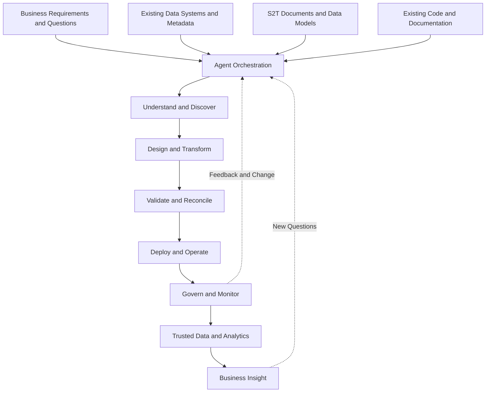

# Agent-Driven Data Platform

**Reduce time to insight without increasing costs.**

An open-source exploration of how AI agents, automation, and structured metadata can help build and maintain end-to-end data platforms, freeing up more time for business analysis and insight.

## About the Project

The aim of this project is to explore how an agent-driven approach can automate the data lifecycle, from understanding business requirements and source systems through to data integration, validation, modelling, and analytics.

Building and maintaining a data platform involves many interconnected activities. Understanding source data, interpreting business rules, developing transformations, maintaining pipelines, investigating data quality issues, and responding to changing requirements can consume significant time and resources.

Much of this work relies on information that already exists in business documentation, Source-to-Target (S2T) mappings, data models, SQL code, data dictionaries, and the knowledge of business analysts and subject matter experts.

The opportunity is to bring these sources of information together and use specialised AI agents and conventional automation to reduce the amount of manual effort required to build, operate, and evolve data systems.

The intended direction is an end-to-end automated data platform where agents can help interpret requirements, understand data structures, propose and validate transformations, support operational maintenance, and make trusted data more accessible for analysis.

The S2T document is one potential entry point for an agent to understand a data project. It provides useful information about how source data maps to target structures, but it is not the only starting point. Depending on the task, an agent could begin with a business question, a set of requirements, an existing database, a data model, or an established data pipeline.

This is an open, collaborative project. The architecture, technology choices, implementation strategy, and scope will evolve through experimentation, practical feedback, and community contributions.

## Goal

**Reduce time to insight without increasing costs.**

The objective is not simply to automate data engineering tasks or generate more code. It is to reduce the time, effort, and cost involved in turning business questions and available data into useful, trusted insight.

Data teams often spend considerable effort maintaining the systems that make analytics possible. Although this work is necessary, the ultimate value of those systems lies in helping people understand their business and make better decisions.

An agent-driven platform could help reduce repetitive development and maintenance tasks, reuse existing knowledge, and shorten the path from a business question to a validated analytical result.

The principle should apply to the platform itself. Automation should not introduce unnecessary infrastructure, additional operational overhead, or expensive AI dependencies without a clear benefit.

Every proposed capability should be considered in terms of the value it provides, the effort it removes, and the cost of delivering and maintaining it.

## The Vision: An Automated Data Lifecycle

The longer-term vision is a platform in which agents can work across the data lifecycle, using available business context, technical metadata, and operational evidence to coordinate tasks that would otherwise require significant manual effort.



This diagram represents the intended direction rather than an existing implementation or a fully autonomous workflow.

The platform should be able to work with existing data estates as well as support new development. In some cases, an agent may help create a new transformation. In others, it may investigate an existing pipeline, assess a change, or help a business analyst understand an analytical question.

The aim is to make these activities part of a connected platform rather than a collection of isolated AI tools.

## Why an Agent-Driven Approach?

An agent-driven approach offers an opportunity to coordinate tasks that span different systems, documents, tools, and areas of expertise.

Rather than expecting one AI model to perform every activity, the platform could use specialised agents with clearly defined responsibilities and access to appropriate tools.

For example, one agent might interpret a business requirement, another might discover relevant data structures, and another might propose a transformation or validation strategy.

Conventional code would remain responsible for deterministic processing, schema checks, and other operations that require predictable behaviour. AI would be used where contextual interpretation, reasoning, or explanation adds value.

The objective is not to maximise the number of agents. It is to determine which tasks benefit from agent-based coordination and which are better handled by simpler, more reliable automation.

## Potential Entry Points

The platform should not depend on a single document or a fixed sequence of steps.

Different users and use cases may provide different starting information.

### Source-to-Target Mapping Documents

S2T documents are a valuable entry point because they often describe the relationship between source and target data, including transformation rules and business logic.

An agent could use an S2T to understand a mapping, identify missing information, explore dependencies, or propose implementation artefacts.

### Business Requirements and Analysis

A business analyst may begin with a question, a requirement, or an understanding of a business problem.

An agent could help identify the relevant business definitions, data assets, and transformations needed to investigate the question.

### Existing Data Platforms

An agent may begin with an existing database, warehouse, lakehouse, data catalogue, or pipeline repository.

With appropriate access, it could inspect available metadata, identify dependencies, and help explain how the existing system operates.

### Existing Code and Documentation

SQL transformations, pipeline definitions, technical documentation, and business glossaries can provide valuable context.

These sources could help the platform understand an existing data estate without requiring every component to be documented in a new format first.

The common requirement is to establish enough reliable context to perform the requested task, while making missing information and uncertainty visible.

## Potential Capabilities

The following areas represent capabilities the project could explore as the platform develops.

### 1\. Data Discovery and Understanding

- Discover source systems, schemas, tables, and columns.
- Interpret available data documentation and mapping specifications.
- Identify potential relationships between data assets.
- Compare documented structures with actual source schemas.
- Highlight gaps in metadata and unresolved business rules.

### 2\. Data Modelling and Transformation

- Interpret existing transformation logic.
- Explore fact and dimension modelling requirements.
- Propose source-to-target mappings and transformation rules.
- Generate draft SQL and data pipeline definitions.
- Identify dependencies and potential implementation issues.

### 3\. Data Quality and Reconciliation

- Derive validation rules from documented requirements.
- Propose nullability, uniqueness, and referential integrity checks.
- Support source-to-target reconciliation.
- Investigate failed checks and suggest possible causes.
- Connect data quality findings to the relevant transformations and business rules.

### 4\. Platform Operations and Maintenance

- Help explain existing pipelines and their dependencies.
- Identify potential impacts of source schema changes.
- Compare versions of mappings, models, and transformations.
- Assist with troubleshooting and operational investigation.
- Reduce repetitive documentation and maintenance effort.

### 5\. Governance and Traceability

- Maintain relationships between requirements, mappings, transformations, and outputs.
- Record the provenance of extracted and inferred metadata.
- Track changes to specifications and generated artefacts.
- Support review and approval workflows.
- Make it easier to understand how data is produced and used.

### 6\. Analytics and Business Insight

- Help identify the datasets relevant to a business question.
- Use approved business definitions and metric calculations.
- Propose analytical queries and investigations.
- Explain the meaning and limitations of results.
- Connect findings to their underlying data and transformation logic.

These capabilities are intended areas of exploration. Their scope and priority should be guided by practical experiments, technical feasibility, and the value they provide.

## A Potential Path: From Business Knowledge to Insight

One of the most valuable opportunities may be to reduce the effort required to translate business knowledge into analytical outcomes.

Business analysts and subject matter experts often understand what needs to be investigated, why it matters, and how the results should be interpreted. The challenge is frequently translating that understanding into the technical steps needed to obtain a reliable answer.

Consider a business analyst investigating declining customer retention.

They may already understand the relevant business definitions and the questions that need answering. The platform could help identify the necessary datasets, discover existing transformations, locate the relevant metrics, and propose an analysis using the available data.

A possible workflow is:

mermaid

```
flowchart TD
    A["Business Question"] --> B["Business Knowledge"]
    B --> C["Agent Identifies Relevant Context"]
    C --> D["Discover Data and Existing Logic"]
    D --> E["Prepare Proposed Analysis"]
    E --> F["Validate Data and Results"]
    F --> G["Business Analyst Reviews Findings"]
    G --> H["Insight and Decision Support"]
```

For example, a business analyst might ask:

> What is driving the change in customer retention across regions?

An agent-assisted workflow could help identify customer and transaction data, find the approved retention definition, explore relevant time periods, and prepare an initial analysis.

The analyst could then focus on evaluating the findings, testing hypotheses, understanding business context, and determining what action might be appropriate.

This is not a promise that every business question can be answered automatically. Some questions will require new data, clarification of business rules, additional modelling, or specialist expertise.

The opportunity is to reduce avoidable technical effort where sufficient information and data already exist.

## The Role of the S2T

S2T documents are an important part of the proposed platform because they provide a practical way to describe how data moves between systems.

However, the platform should treat an S2T as one source of context rather than a mandatory first phase.

Depending on the task, an agent might:

- Start with an S2T and generate a structured representation of its mappings.
- Start with a source database and discover its schema.
- Start with a business requirement and identify the relevant data assets.
- Start with an existing pipeline and investigate its behaviour.
- Start with a data quality failure and trace the affected transformations.

Where an S2T is available, it may provide useful evidence about source and target relationships, business rules, and intended transformations.

A typical workbook might include:

| Area | Examples |
| --- | --- |
| Source details | Source system, database, schema, and environment |
| Source mappings | Source tables, columns, and data types |
| Target mappings | Target tables, columns, and data types |
| Transformations | Expressions, joins, filters, and derivations |
| Facts and dimensions | Measures, attributes, keys, and relationships |
| Business rules | Inclusion criteria, calculations, and constraints |
| Documentation | Descriptions, assumptions, and implementation notes |

Workbook layouts may differ between projects. The platform should explore flexible parsing and configurable conventions rather than assume a universal template.

Secrets such as passwords, tokens, and private keys must not be stored in S2T documents or exposed to AI models.

## Metadata and Knowledge Representation

A reusable metadata model could help agents share a consistent understanding of the data estate.

Potential entities include:

| Entity | Purpose |
| --- | --- |
| Project | Groups related requirements and data assets |
| Source system | Identifies where data originates |
| Table and column | Describes physical data structures |
| Mapping rule | Describes relationships between source and target fields |
| Transformation | Captures expressions, joins, filters, and derivations |
| Fact definition | Describes measures, keys, and declared grain |
| Dimension definition | Describes keys and descriptive attributes |
| Relationship | Defines dependencies and join conditions |
| Business rule | Captures business logic and interpretation |
| Data quality rule | Defines a testable expectation |
| Lineage relationship | Connects upstream and downstream assets |
| Operational record | Captures relevant execution and validation evidence |

The metadata model should evolve as practical use cases emerge. An initial implementation does not need to include every entity or support every data platform.

A key design consideration is the distinction between documented information, discovered information, and AI-generated proposals.

The platform should preserve this distinction so that users can understand what is known, what has been inferred, and what still requires confirmation.

## Design Principles

The following principles should guide the project.

- **Business value first:** Prioritise capabilities that reduce time to insight or avoid unnecessary costs.
- **End-to-end thinking:** Consider how discovery, engineering, validation, operations, and analytics fit together.
- **Incremental implementation:** Build and evaluate useful capabilities without requiring the entire vision to be implemented at once.
- **Structured context:** Make relevant metadata available in forms that can be reused across tasks.
- **Deterministic processing where possible:** Use conventional code for parsing, validation, and predictable operations.
- **AI where it adds value:** Explore AI for interpretation, reasoning, suggestions, and explanations.
- **Visible uncertainty:** Distinguish verified facts from assumptions and inferred information.
- **Reviewable outputs:** Make generated transformations, analyses, and recommendations inspectable.
- **Security by design:** Apply appropriate permissions and safeguards to data access and execution.
- **Cost awareness:** Evaluate infrastructure, model usage, operational overhead, and maintenance alongside productivity.
- **Open collaboration:** Keep architectural decisions open to discussion and alternative approaches.

## Potential Technology Choices

The technology stack is not fixed. Candidate options include:

| Area | Possible options |
| --- | --- |
| Core development | Python |
| Workbook parsing | `openpyxl`, `pandas` |
| API layer | FastAPI |
| Metadata validation | Pydantic or JSON Schema |
| Metadata storage | PostgreSQL or an existing metadata platform |
| Workflow orchestration | Lightweight custom workflows or an established orchestration framework |
| Agent framework | An established framework or a custom implementation |
| SQL analysis | SQLGlot and database-native validation |
| Data quality | Existing data quality frameworks or custom rules |
| Observability | Structured logs, metrics, tracing, and audit records |

These are options for experimentation, not required dependencies.

The project should favour a modular approach that can work with existing enterprise systems where practical. Additional infrastructure should be introduced only when there is a clear technical or business justification.

## Security and Human Oversight

An automated platform must operate within clearly defined boundaries.

Potential considerations include:

- Separating credentials from documents, prompts, and generated code.
- Using least-privilege access to source and target systems.
- Restricting the operations agents are permitted to perform.
- Validating generated SQL and other executable artefacts.
- Requiring appropriate approval for consequential changes.
- Keeping records of generated outputs and execution outcomes.
- Avoiding unnecessary exposure of sensitive data to AI models.
- Distinguishing proposed changes from approved changes.

The aim is to automate routine work while maintaining appropriate control over business logic, data access, and operational changes.

The degree of autonomy should be appropriate to the task and the evidence available, rather than assuming every process should be fully autonomous.

## Development Approach

The project is intended to develop through small experiments that contribute towards the broader end-to-end vision.

Possible areas of initial work include:

- [ ]Define the core use cases and problem boundaries.
- [ ]Identify representative data engineering workflows.
- [ ]Explore how existing documents and metadata can be used as agent context.
- [ ]Establish a small, testable metadata representation.
- [ ]Experiment with an agent completing a clearly defined task.
- [ ]Evaluate output quality, manual effort, and operating costs.
- [ ]Document limitations and lessons learned.
- [ ]Use practical results to prioritise subsequent work.

These are suggested activities rather than a mandatory sequence. Different contributors may be interested in different entry points, and the project should allow those contributions to inform its direction.

## Measuring Success

The project should be evaluated by the outcomes it helps achieve, not by the number of agents, tools, or generated artefacts.

Potential measures include:

- Time required to understand and modify existing data systems.
- Time spent investigating routine data issues.
- Time from a business question to a validated analytical result.
- Reduction in repetitive manual work.
- Accuracy and reproducibility of generated outputs.
- Amount of review and rework required.
- Cost of developing, running, and maintaining the solution.
- Ability to trace results back to relevant data and business definitions.
- Time released for analysis and decision support.

The goal is not to assume that automation will always be faster or cheaper. It is to test where it creates measurable value and where simpler approaches are more appropriate.

A solution that generates code quickly but requires extensive rework or expensive infrastructure may not represent meaningful progress.

## Getting Involved

This is a public, collaborative project. Contributions can help shape both the technical implementation and the direction of the platform.

Areas where input would be useful include:

- Agent architecture and orchestration.
- Data engineering automation.
- Metadata modelling and data catalogues.
- S2T parsing and transformation logic.
- Fact and dimension modelling.
- Data quality and reconciliation.
- Data lineage and impact analysis.
- Business analysis and semantic modelling.
- Natural-language analytics.
- Cost-effective AI and automation.
- Testing, documentation, and example workflows.

Contributions do not need to involve implementing a complete agent or building a large feature. A small experiment, representative test case, architectural suggestion, or documented limitation can be equally valuable.

Constructive criticism and alternative approaches are welcome.

Please use sanitised examples and avoid contributing credentials, confidential business information, or production data.

For substantial changes, opening an issue first can help establish whether the proposed approach fits the project's direction.

A dedicated `CONTRIBUTING.md` can be introduced as the development workflow becomes clearer.

## Repository Status

This repository represents an exploration of an ambitious direction, not a claim that an end-to-end automated data platform already exists.

The vision is to connect data engineering and analytics activities through reusable metadata, automation, and specialised agents. The implementation will need to establish which capabilities are practical, reliable, and cost-effective.

The project should remain open to different technical approaches and should evolve through working examples, measurable results, and collaboration.

## Long-Term Direction

The long-term ambition is to make data platforms easier to build, understand, operate, and evolve by reducing the manual effort required across their lifecycle.

The opportunity extends beyond generating SQL or interpreting S2T documents. It is about connecting business requirements, existing data systems, technical metadata, operational workflows, and analytical questions within a coherent platform.

If successful, this approach could help teams spend less time maintaining the machinery of analytics and more time using data to understand their business and make better decisions.

The S2T is one useful entry point. The wider goal is to make the data lifecycle more automated, connected, and accessible.

**Reduce time to insight without increasing costs.**

That is the principle against which proposed features, architecture decisions, and future extensions should be evaluated.

Ideas, experiments, feedback, and contributions are welcome. Let's explore what can be automated, establish what works in practice, and build towards the vision together.
